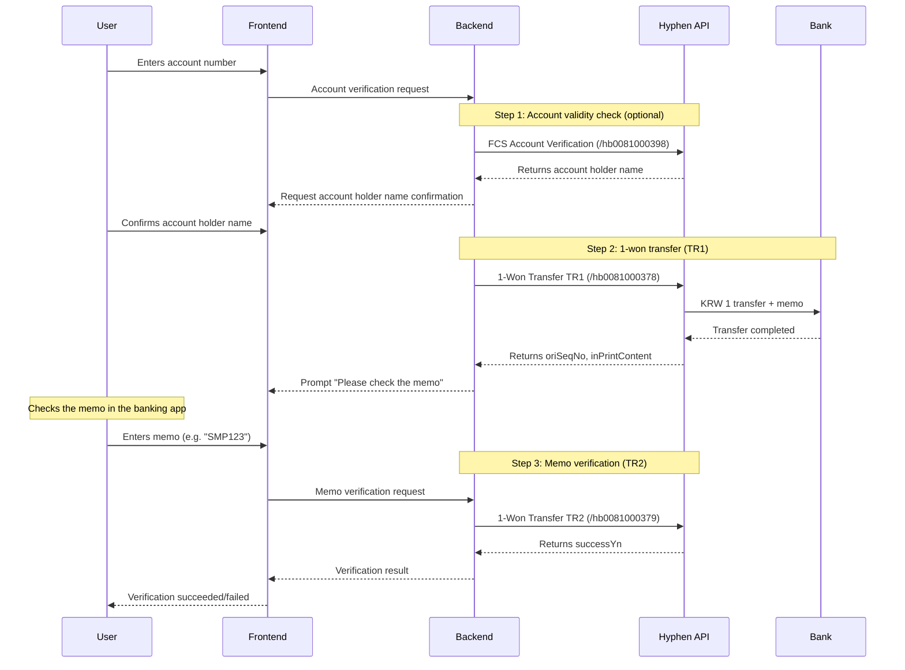

# Bank Account Verification (1-Won Verification) API Guide

This guide covers integrating the Hyphen 1-won verification API to confirm bank account ownership.

## Table of Contents

1. [Overview](#1-overview)
2. [Prerequisites](#2-prerequisites)
3. [Authentication (OAuth 2.0)](#3-authentication-oauth-20)
4. [API Specification](#4-api-specification)
5. [Verification Flow](#5-verification-flow)
6. [Bank Code Table](#6-bank-code-table)
7. [Use Cases](#7-use-cases)
8. [Error Handling and Considerations](#8-error-handling-and-considerations)

---

## 1. Overview

### 1.1 What Is 1-Won Verification?

1-won verification (bank account ownership verification) is an identity check in which 1 won (KRW 1) is transferred to the user's account, and the user reads the **verification memo (shown as the depositor name)** sent with the transfer and enters it to confirm ownership.

```
[Verification flow]
1. The user enters their own account number
2. The system transfers KRW 1 to that account (memo: a short Korean word such as "paran-haneul" (blue sky))
3. The user checks the memo in their banking app / internet banking
4. The user enters the memo to complete verification
```

### 1.2 Hyphen Firm Banking API

1-won verification can be implemented through [Hyphen](https://hyphen.im)'s firm banking API.

- **API documentation**: https://hyphen.im/product-api/view?seq=31
- **Supported banks**: All major Korean banks
- **Security certification**: ISMS (Information Security Management System) certified

### 1.3 Use in SubHub

| Purpose                               | Description                                                     |
| ------------------------------------- | --------------------------------------------------------------- |
| **Payment account registration**      | Verify ownership of the account used to pay SaaS subscriptions  |
| **Refund account verification**       | Verify ownership of the account that receives refunds           |
| **Organisation account registration** | Verify when registering a corporate/team shared account         |
| **Enhanced security**                 | Additional verification when sensitive financial details change |

### 1.4 Available APIs

| API                      | Endpoint        | Function                                            |
| ------------------------ | --------------- | --------------------------------------------------- |
| FCS Account Verification | `/hb0081000398` | Account validity check (account holder name lookup) |
| **1-Won Transfer TR1**   | `/hb0081000378` | 1-won transfer request (starts verification)        |
| **1-Won Transfer TR2**   | `/hb0081000379` | Memo verification (completes verification)          |

---

## 2. Prerequisites

### 2.1 Hyphen Sign-Up and Product Application

1. [Sign up for Hyphen](https://hyphen.im/user/sign-up)
2. After logging in, apply for the "1-Won Verification (Bank Account Ownership Verification)" product
3. Credentials are issued (the Hkey is delivered by email)

### 2.2 Choose a Pricing Plan

| Plan             | Characteristics                       | Billing Method                            |
| ---------------- | ------------------------------------- | ----------------------------------------- |
| **TR Slim**      | Use immediately, no contract required | Prepaid; deducted from topped-up BizMoney |
| **TR Signature** | Contract required                     | Postpaid invoicing                        |

> **Testing**: Free testing is provided for 100 calls per day and 100 calls per month

### 2.3 Prepare Credentials

```
user_id: The ID created at sign-up
hkey: The security key delivered by email after sign-up
```

---

## 3. Authentication (OAuth 2.0)

### 3.1 Issue an Access Token

**Endpoint**

```
POST https://api.hyphen.im/oauth/token
```

**Request**

```typescript
// Header
{ "Content-Type": "application/json" }

// Body
{
  "user_id": "your_user_id",
  "hkey": "your_hkey"
}
```

**Response**

```json
{
  "access_token": "075a2d84-dab4-983e-a103-efb5d782b874",
  "token_type": "bearer",
  "expires_in": 603638,
  "scope": "read"
}
```

### 3.2 API Call Methods

**Using an OAuth token (recommended)**

```typescript
{
  "Authorization": "Bearer {access_token}",
  "Content-Type": "application/json"
}
```

**Direct authentication (alternative)**

```typescript
{
  "user-id": "your_user_id",
  "Hkey": "your_hkey",
  "Content-Type": "application/json"
}
```

---

## 4. API Specification

### 4.1 FCS Account Verification (Account Validity Check)

Checks that an account number is valid and returns the account holder name. Use it as a pre-check before the 1-won transfer.

**Endpoint**

```
POST https://api.hyphen.im/hb0081000398
```

**Request Body**

```typescript
interface AccountVerifyRequest {
  bank_cd: string; // 3-digit bank code (required)
  acct_no: string; // Account number (required)
  id_no?: string; // Identity number (6-digit date of birth or business registration number)
  amount?: string; // Amount (used for virtual account lookups)
}
```

**Response**

```typescript
interface AccountVerifyResponse {
  name: string; // Account holder name
  reply: string; // Response code
  reply_msg: string; // Response message
}
```

**JavaScript Example**

```javascript
const verifyAccount = async (bankCode, accountNo) => {
  const response = await fetch("https://api.hyphen.im/hb0081000398", {
    method: "POST",
    headers: {
      "Content-Type": "application/json",
      Authorization: `Bearer ${accessToken}`,
    },
    body: JSON.stringify({
      bank_cd: bankCode, // "088" (Shinhan Bank)
      acct_no: accountNo, // "110123456789"
    }),
  });

  const data = await response.json();
  return data; // { name: "Hong Gil-dong", reply: "0000", reply_msg: "Normal" } (name and reply_msg are returned in Korean by the API; check `reply`, not `reply_msg`)
};
```

---

### 4.2 1-Won Transfer TR1 (1-Won Transfer Request)

Transfers KRW 1 to the user's account and sends the verification memo. This is **the first step of the verification process**.

**Endpoint**

```
POST https://api.hyphen.im/hb0081000378
```

**Request Body**

```typescript
interface OneWonTransferRequest {
  inBankCode: string; // Beneficiary bank code (required, e.g. "088")
  inAccount: string; // Beneficiary account number (required)
  msgType?: string; // Verification memo type (default: "1")
  // "1": Four Korean characters (e.g. "paran-haneul", meaning "blue sky")
  // "2": Company name + 3 digits (e.g. SMP123)
  // "3": Custom text
  compName?: string; // Company name (max 7 characters, required when msgType=2)
  printContent?: string; // Custom memo text (max 10 characters, required when msgType=3)
}
```

**Response**

```typescript
interface OneWonTransferResponse {
  replyCode: string; // Response code
  replyMessage: string; // Response message
  sign: string; // Signature
  successYn: string; // Success flag ("Y" | "N")
  tradeTime: string; // Transaction time
  inPrintContent: string; // **Verification memo** (the answer the user must enter)
  svcCharge: string; // Service fee
  oriSeqNo: string; // **Verification sequence number** (used in TR2)
  tr_date: string; // Transaction date (yyyy-mm-dd)
  error?: string; // Error message
}
```

**JavaScript Example**

```javascript
const sendOneWon = async (bankCode, accountNo) => {
  const response = await fetch("https://api.hyphen.im/hb0081000378", {
    method: "POST",
    headers: {
      "Content-Type": "application/json",
      Authorization: `Bearer ${accessToken}`,
    },
    body: JSON.stringify({
      inBankCode: bankCode, // "088"
      inAccount: accountNo, // "110123456789"
      msgType: "1", // Four-Korean-character memo
    }),
  });

  const data = await response.json();

  if (data.successYn === "Y") {
    // Store the verification details (used in TR2)
    return {
      oriSeqNo: data.oriSeqNo, // Verification sequence number
      inPrintContent: data.inPrintContent, // Correct memo (store on the server only)
      tr_date: data.tr_date, // Transaction date
    };
  }

  throw new Error(data.error || data.replyMessage);
};
```

---

### 4.3 1-Won Transfer TR2 (Memo Verification)

Verifies the memo entered by the user to complete verification. This is **the second step of the verification process**.

**Endpoint**

```
POST https://api.hyphen.im/hb0081000379
```

**Request Body**

```typescript
interface VerifyPrintContentRequest {
  oriSeqNo: string; // Verification sequence number (value received from TR1, required)
  inPrintContent: string; // Memo entered by the user (required)
  // ⚠️ Must be entered within 5 minutes
  tr_date?: string; // Transaction date (yyyy-mm-dd)
}
```

**Response**

```typescript
interface VerifyPrintContentResponse {
  successYn: string; // Verification success flag ("Y" | "N")
  error?: string; // Error message
}
```

**JavaScript Example**

```javascript
const verifyPrintContent = async (oriSeqNo, userInput, trDate) => {
  const response = await fetch("https://api.hyphen.im/hb0081000379", {
    method: "POST",
    headers: {
      "Content-Type": "application/json",
      Authorization: `Bearer ${accessToken}`,
    },
    body: JSON.stringify({
      oriSeqNo: oriSeqNo, // Value received from TR1
      inPrintContent: userInput, // Memo entered by the user (e.g. the Korean word "paran-haneul")
      tr_date: trDate, // "2024-11-30"
    }),
  });

  const data = await response.json();

  if (data.successYn === "Y") {
    return { verified: true };
  }

  return { verified: false, error: data.error };
};
```

---

## 5. Verification Flow

### 5.1 End-to-End Verification Process



### 5.2 Implementation Example (Next.js Server Action)

```typescript
// src/actions/bank-verification.ts
"use server";

import { prisma } from "@/lib/db";

interface BankVerificationState {
  step: "input" | "verify" | "complete";
  accountName?: string;
  oriSeqNo?: string;
  trDate?: string;
  error?: string;
}

// Step 1: 1-won transfer request
export async function requestOneWonTransfer(
  bankCode: string,
  accountNo: string,
  userId: string
): Promise<BankVerificationState> {
  const accessToken = await getHyphenToken();

  // 1-won transfer request (TR1)
  const response = await fetch("https://api.hyphen.im/hb0081000378", {
    method: "POST",
    headers: {
      "Content-Type": "application/json",
      Authorization: `Bearer ${accessToken}`,
    },
    body: JSON.stringify({
      inBankCode: bankCode,
      inAccount: accountNo,
      msgType: "2",
      compName: "SMP", // SubHub
    }),
  });

  const data = await response.json();

  if (data.successYn !== "Y") {
    return { step: "input", error: data.error || "Transfer request failed" };
  }

  // Store the verification session (valid for 5 minutes)
  await prisma.bankVerificationSession.create({
    data: {
      userId,
      bankCode,
      accountNo,
      oriSeqNo: data.oriSeqNo,
      inPrintContent: data.inPrintContent, // Correct answer (store on the server only)
      trDate: data.tr_date,
      expiresAt: new Date(Date.now() + 5 * 60 * 1000), // 5 minutes
    },
  });

  return {
    step: "verify",
    oriSeqNo: data.oriSeqNo,
    trDate: data.tr_date,
  };
}

// Step 2: Memo verification
export async function verifyPrintContent(
  oriSeqNo: string,
  userInput: string,
  userId: string
): Promise<BankVerificationState> {
  const session = await prisma.bankVerificationSession.findFirst({
    where: {
      userId,
      oriSeqNo,
      expiresAt: { gt: new Date() },
    },
  });

  if (!session) {
    return { step: "input", error: "The verification session has expired." };
  }

  const accessToken = await getHyphenToken();

  // Memo verification (TR2)
  const response = await fetch("https://api.hyphen.im/hb0081000379", {
    method: "POST",
    headers: {
      "Content-Type": "application/json",
      Authorization: `Bearer ${accessToken}`,
    },
    body: JSON.stringify({
      oriSeqNo,
      inPrintContent: userInput,
      tr_date: session.trDate,
    }),
  });

  const data = await response.json();

  if (data.successYn === "Y") {
    // Verification complete - save the account details
    await prisma.verifiedBankAccount.create({
      data: {
        userId,
        bankCode: session.bankCode,
        accountNo: session.accountNo,
        verifiedAt: new Date(),
      },
    });

    // Delete the session
    await prisma.bankVerificationSession.delete({
      where: { id: session.id },
    });

    return { step: "complete" };
  }

  return {
    step: "verify",
    oriSeqNo,
    trDate: session.trDate,
    error: "The memo does not match. Please check and try again.",
  };
}
```

### 5.3 Frontend Component Example

```tsx
// src/components/BankVerification.tsx
"use client";

import { useState } from "react";
import { Button } from "@/components/ui/button";
import { Input } from "@/components/ui/input";
import {
  Select,
  SelectContent,
  SelectItem,
  SelectTrigger,
  SelectValue,
} from "@/components/ui/select";
import {
  requestOneWonTransfer,
  verifyPrintContent,
} from "@/actions/bank-verification";
import { BANK_CODES } from "@/lib/constants";

export function BankVerification({ userId }: { userId: string }) {
  const [step, setStep] = useState<"input" | "verify" | "complete">("input");
  const [bankCode, setBankCode] = useState("");
  const [accountNo, setAccountNo] = useState("");
  const [printContent, setPrintContent] = useState("");
  const [oriSeqNo, setOriSeqNo] = useState("");
  const [error, setError] = useState("");
  const [loading, setLoading] = useState(false);

  const handleRequestTransfer = async () => {
    setLoading(true);
    setError("");

    const result = await requestOneWonTransfer(bankCode, accountNo, userId);

    if (result.error) {
      setError(result.error);
    } else if (result.step === "verify") {
      setOriSeqNo(result.oriSeqNo!);
      setStep("verify");
    }

    setLoading(false);
  };

  const handleVerify = async () => {
    setLoading(true);
    setError("");

    const result = await verifyPrintContent(oriSeqNo, printContent, userId);

    if (result.error) {
      setError(result.error);
    } else if (result.step === "complete") {
      setStep("complete");
    }

    setLoading(false);
  };

  if (step === "complete") {
    return (
      <div className="p-4 text-center">
        <p className="font-medium text-green-600">
          Your bank account has been verified.
        </p>
      </div>
    );
  }

  return (
    <div className="space-y-4 p-4">
      {step === "input" && (
        <>
          <Select value={bankCode} onValueChange={setBankCode}>
            <SelectTrigger>
              <SelectValue placeholder="Select bank" />
            </SelectTrigger>
            <SelectContent>
              {BANK_CODES.map((bank) => (
                <SelectItem key={bank.code} value={bank.code}>
                  {bank.name}
                </SelectItem>
              ))}
            </SelectContent>
          </Select>

          <Input
            placeholder="Account number (digits only, no hyphens)"
            value={accountNo}
            onChange={(e) => setAccountNo(e.target.value.replace(/\D/g, ""))}
          />

          <Button
            onClick={handleRequestTransfer}
            disabled={loading || !bankCode || !accountNo}
          >
            {loading ? "Processing..." : "Request 1-won verification"}
          </Button>
        </>
      )}

      {step === "verify" && (
        <>
          <p className="text-muted-foreground text-sm">
            We have transferred KRW 1 to the account you entered.
            <br />
            Please check the <strong>depositor name (memo)</strong> on the
            deposit in your banking app and enter it below.
          </p>
          <p className="text-muted-foreground text-xs">
            ⏱️ Please enter it within 5 minutes.
          </p>

          <Input
            placeholder="Enter depositor name (e.g. SMP123)"
            value={printContent}
            onChange={(e) => setPrintContent(e.target.value)}
          />

          <Button onClick={handleVerify} disabled={loading || !printContent}>
            {loading ? "Verifying..." : "Complete verification"}
          </Button>
        </>
      )}

      {error && <p className="text-destructive text-sm">{error}</p>}
    </div>
  );
}
```

---

## 6. Bank Code Table

### 6.1 Major Bank Codes (3 Digits)

| Code | Bank Name                                 | Code | Bank Name                        |
| ---- | ----------------------------------------- | ---- | -------------------------------- |
| 001  | Bank of Korea                             | 020  | Woori Bank                       |
| 002  | KDB Korea Development Bank                | 023  | SC First Bank                    |
| 003  | IBK Industrial Bank of Korea              | 027  | Citibank Korea                   |
| 004  | KB Kookmin Bank                           | 031  | iM Bank (formerly Daegu Bank)    |
| 007  | Sh Suhyup Bank                            | 032  | Busan Bank                       |
| 008  | Export-Import Bank of Korea               | 034  | Kwangju Bank                     |
| 011  | NH NongHyup Bank                          | 035  | Jeju Bank                        |
| 012  | Local NongHyup and livestock cooperatives | 037  | Jeonbuk Bank                     |
| 020  | Woori Bank                                | 039  | Kyongnam Bank                    |
| 081  | Hana Bank                                 | 045  | MG Community Credit Cooperatives |
| 088  | Shinhan Bank                              | 048  | Shinhyup Credit Union            |
| 089  | K Bank                                    | 050  | Savings banks                    |
| 090  | KakaoBank                                 | 071  | Korea Post                       |
| 092  | Toss Bank                                 | -    | -                                |

### 6.2 Bank Code Constant Definitions

```typescript
// src/lib/constants/bank-codes.ts
export const BANK_CODES = [
  { code: "004", name: "KB Kookmin Bank" },
  { code: "088", name: "Shinhan Bank" },
  { code: "020", name: "Woori Bank" },
  { code: "081", name: "Hana Bank" },
  { code: "011", name: "NH NongHyup Bank" },
  { code: "003", name: "IBK Industrial Bank of Korea" },
  { code: "090", name: "KakaoBank" },
  { code: "089", name: "K Bank" },
  { code: "092", name: "Toss Bank" },
  { code: "023", name: "SC First Bank" },
  { code: "031", name: "iM Bank (formerly Daegu Bank)" },
  { code: "032", name: "Busan Bank" },
  { code: "034", name: "Kwangju Bank" },
  { code: "037", name: "Jeonbuk Bank" },
  { code: "039", name: "Kyongnam Bank" },
  { code: "035", name: "Jeju Bank" },
  { code: "071", name: "Korea Post" },
  { code: "045", name: "MG Community Credit Cooperatives" },
  { code: "048", name: "Shinhyup Credit Union" },
] as const;

export type BankCode = (typeof BANK_CODES)[number]["code"];
```

---

## 7. Use Cases

### 7.1 Payment Account Registration Flow

```typescript
// When a user registers an account for automatic SaaS subscription payments
async function registerPaymentAccount(
  userId: string,
  bankCode: string,
  accountNo: string
) {
  // 1. Account validity check
  const accountInfo = await verifyAccount(bankCode, accountNo);

  // 2. Run 1-won verification
  const transfer = await requestOneWonTransfer(bankCode, accountNo, userId);

  // 3. Wait for the user to enter the memo...

  // 4. Register the account once verification is complete
  await prisma.paymentAccount.create({
    data: {
      userId,
      bankCode,
      accountNo,
      accountHolder: accountInfo.name,
      isVerified: true,
    },
  });
}
```

### 7.2 Organisation Payment Method Management

```typescript
// When an organisation administrator registers the team payment account
async function registerOrganizationAccount(
  organizationId: string,
  adminUserId: string,
  bankCode: string,
  accountNo: string
) {
  // Confirm administrator permissions
  const isAdmin = await checkOrganizationAdmin(organizationId, adminUserId);
  if (!isAdmin) throw new Error("You do not have permission.");

  // Run 1-won verification
  const result = await performOneWonVerification(
    bankCode,
    accountNo,
    adminUserId
  );

  if (result.verified) {
    await prisma.organization.update({
      where: { id: organizationId },
      data: {
        paymentBankCode: bankCode,
        paymentAccountNo: accountNo,
        paymentAccountVerifiedAt: new Date(),
        paymentAccountVerifiedBy: adminUserId,
      },
    });
  }
}
```

---

## 8. Error Handling and Considerations

### 8.1 Key Error Cases

| Situation             | Cause                                          | Response                                          |
| --------------------- | ---------------------------------------------- | ------------------------------------------------- |
| Account lookup failed | Incorrect account number / bank code           | Ask the user to re-check their input              |
| Transfer failed       | Account status issue (closed, suspended, etc.) | Ask the user to use a different account           |
| Memo mismatch         | User input error                               | Ask the user to re-enter (limit of 3 recommended) |
| Timed out             | Not entered within 5 minutes                   | Restart from the beginning                        |

### 8.2 Memo Entry Time Limit

```
⚠️ Important: The memo must be entered within 5 minutes of the 1-won transfer.
```

```typescript
// Session expiry check
function isSessionExpired(createdAt: Date): boolean {
  const FIVE_MINUTES = 5 * 60 * 1000;
  return Date.now() - createdAt.getTime() > FIVE_MINUTES;
}
```

### 8.3 Security Considerations

```
⚠️ Security considerations

1. Never expose the verification answer (inPrintContent) to the client
2. Use oriSeqNo for verification on the server only
3. Isolate verification sessions per user
4. Limit the number of retries (3-5 recommended)
5. Manage Hyphen credentials (hkey) via environment variables
```

```typescript
// .env configuration
HYPHEN_USER_ID = your_user_id;
HYPHEN_HKEY = your_hkey;
```

### 8.4 Retry Limit on Verification Failure

```typescript
// Retry count management
const MAX_RETRY = 3;

async function verifyWithRetryLimit(
  userId: string,
  oriSeqNo: string,
  userInput: string
) {
  const session = await prisma.bankVerificationSession.findFirst({
    where: { userId, oriSeqNo },
  });

  if (!session) {
    throw new Error("Session not found.");
  }

  if (session.retryCount >= MAX_RETRY) {
    await prisma.bankVerificationSession.delete({ where: { id: session.id } });
    throw new Error(
      "You have exceeded the maximum number of verification attempts. Please start again."
    );
  }

  const result = await verifyPrintContent(oriSeqNo, userInput, userId);

  if (!result.verified) {
    await prisma.bankVerificationSession.update({
      where: { id: session.id },
      data: { retryCount: session.retryCount + 1 },
    });
  }

  return result;
}
```

### 8.5 Test Environment

- **Free testing**: 100 calls per day, 100 calls per month
- **When testing**: Add the `hyphen-gustation: Y` header
- **In production**: Remove that header

---

## References

- [Hyphen 1-Won Verification API Specification](https://hyphen.im/product-api/view?seq=31#product-api-specification)
- [Hyphen OAuth 2.0 Guide](https://hyphen.im/product-api/view?seq=31#product-api-oauth)
- [Hyphen Code List](https://hyphen.im/product-api/view?seq=31#product-api-code)
- [Firm Banking Bank Response Codes (Excel)](https://kr.object.ncloudstorage.com/synctree/datamarket/static/product/codezip/%5BHYPHEN%5D%20%EC%8B%A4%EC%8B%9C%EA%B0%84%20%ED%8E%8C%EB%B1%85%ED%82%B9%20%EC%9D%80%ED%96%89%EC%9D%91%EB%8B%B5%EC%BD%94%EB%93%9C.xlsx)

---

**Customer Support (Hyphen)**

- Phone: 1600-4173 (option 1: firm banking)
- Email: fbs@hyphen.im (firm banking), help@hyphen.im (API Market)
- Support hours: Weekdays 08:30 - 17:30 (KST)
